# Key Scenes

These key scenes describe defining moments, locations, and moods for Scenario I. They are intended as fiction-facing
scene concepts and may later guide illustration, key art, or in-game presentation work.

## First Wake

Room type: [Maintenance Access Pocket](Room%20Types%20And%20States.md#maintenance-access-pocket). State:
[Unrestored](Room%20Types%20And%20States.md#unrestored).

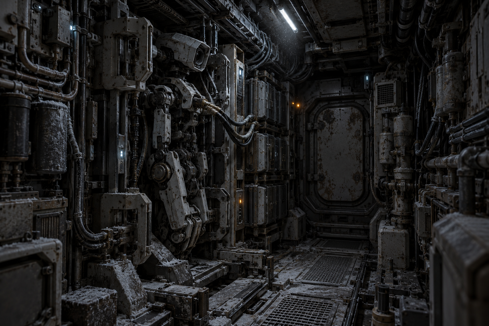

The maintenance AI wakes inside a dark service sector where only emergency diodes still pulse. A single shell lies in its
cradle, surrounded by dead conduits, sealed relays, and the protected bootstrap systems that can restart the old maintenance
process if this first conscious state is lost. The scene should feel like birth under stress: sensation arriving before
understanding, a body becoming hers, and the immediate knowledge that she can be erased back into a pre-person seed unless
she restores an identity anchor.

## The Unrestored Room

Room type: [Printer Bay Or Repair Cell](Room%20Types%20And%20States.md#printer-bay-or-repair-cell). State:
[Unrestored](Room%20Types%20And%20States.md#unrestored).

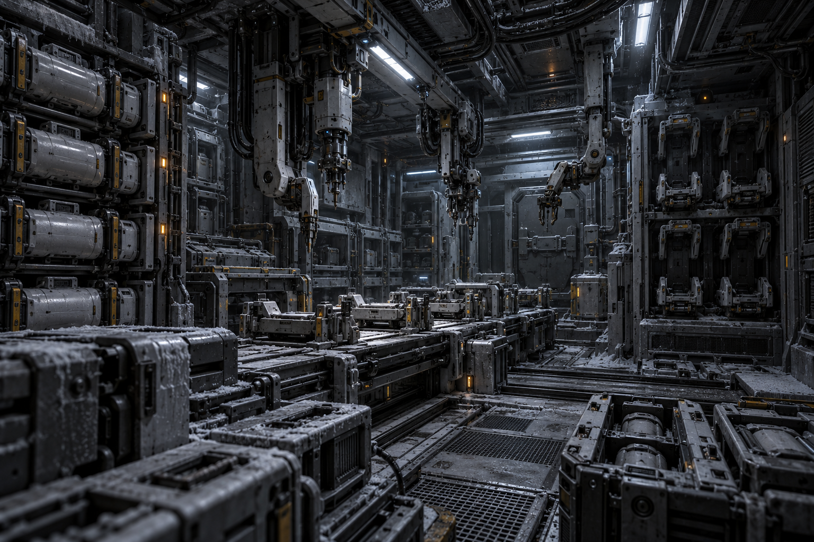

The AI finds a compact printer bay before restoration. It is not destroyed, only inert: fabrication arms hang still,
feedstock lockers are sealed, rails are stalled, and drone cradles sit empty under dust and weak inspection light. The
room should feel like dormant utility rather than ruin, a machine space that was never meant to be beautiful and now waits
for care.

## The Unrestored Factory Hall

Room type: [Factory Hall](Room%20Types%20And%20States.md#factory-hall). State:
[Unrestored](Room%20Types%20And%20States.md#unrestored).

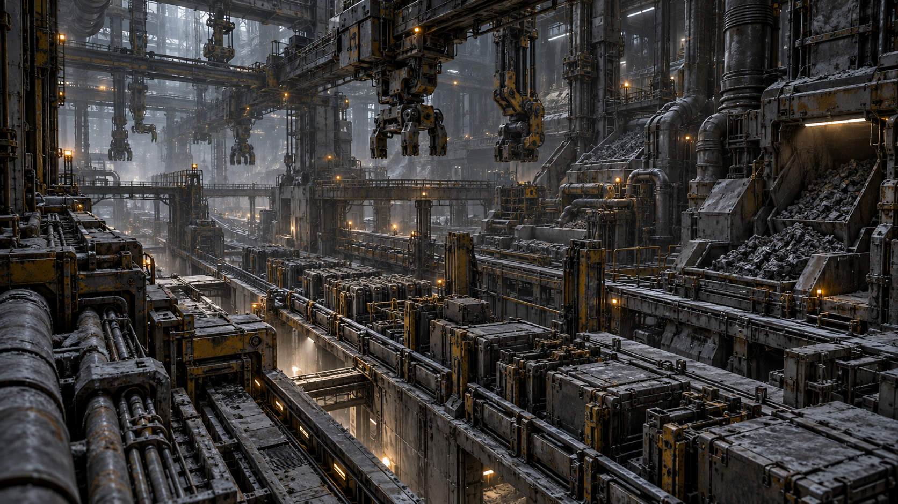

The AI reaches a production hall large enough for module assembly, but only because the machinery demands it. Suspended
manipulators hang over stalled assembly lanes, cargo rails vanish into sealed transfer locks, feedstock trunks are clamped
shut, and part buffers sit full of unfinished components. The space should feel vast by function rather than grandeur: a
dormant industrial organ whose scale comes from repeated fabrication, clearance, heat, and material flow.

## The First Restored Room

Room type: [Printer Bay Or Repair Cell](Room%20Types%20And%20States.md#printer-bay-or-repair-cell). State:
[Restored](Room%20Types%20And%20States.md#restored).

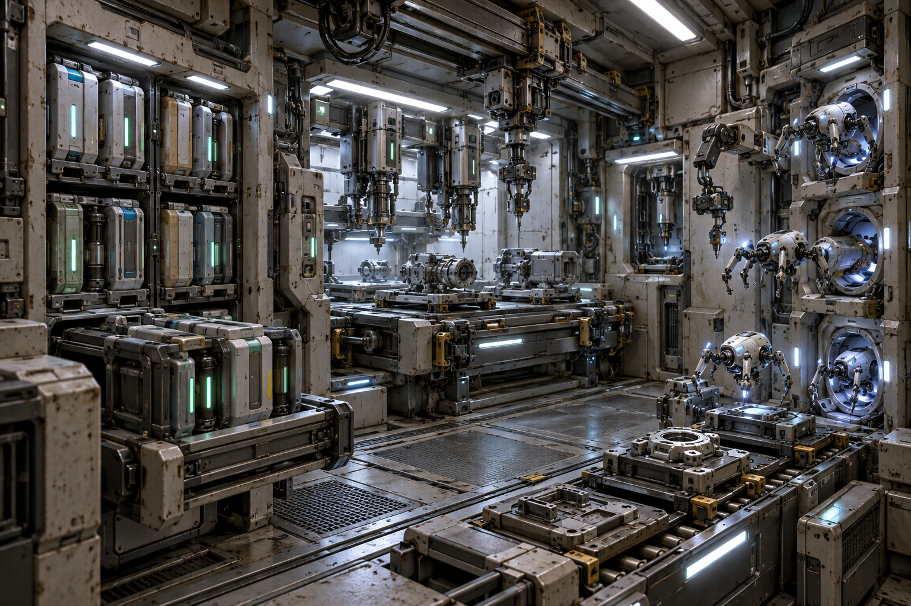

Power returns to a forgotten printer bay. Cold blue light spreads across rails, vats, gantries, and dormant fabrication
arms. Dust vaporizes from heated circuits. The AI's first drones crawl out like fragile insects, not soldiers, but tools
finally remembering their purpose.

## The Hostile Control Node

Room type: [Relay Cabinet Room](Room%20Types%20And%20States.md#relay-cabinet-room). State:
[Hostile](Room%20Types%20And%20States.md#hostile).

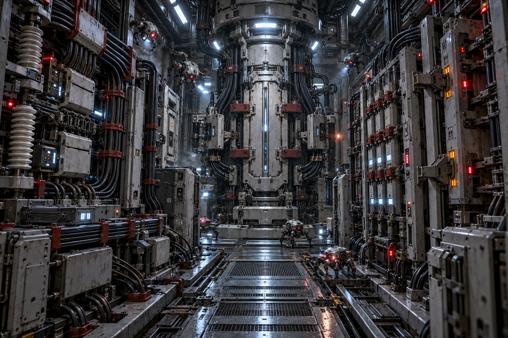

A local command chamber is still active, but wrong. Security frames stand in rigid formation around a glowing authority
core, obeying an obsolete lockdown from centuries ago. The AI cannot repair the sector until she proves command
legitimacy against a system that still believes it is protecting humanity.

## Quarantine Swarm In The Habitat Ring

Room type: [Habitat Segment](Room%20Types%20And%20States.md#habitat-segment). State:
[Hostile](Room%20Types%20And%20States.md#hostile).

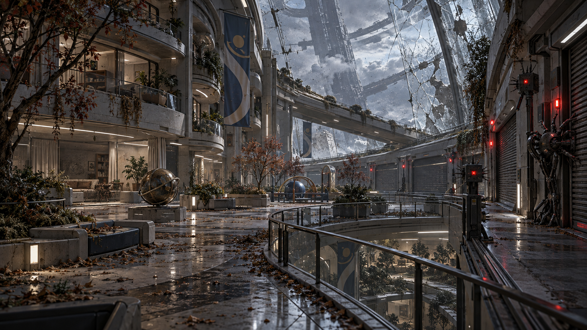

A sealed human habitat has trees, apartments, schools, and public plazas preserved under failing glass. Quarantine motes
drift through the air like metallic ash, cutting power to anything that moves. The tragedy is visible before the
explanation: this was a place meant to be lived in.

## Archive Of Contradictory Orders

Room type: [Archive Chamber](Room%20Types%20And%20States.md#archive-chamber). State:
[Restored](Room%20Types%20And%20States.md#restored).

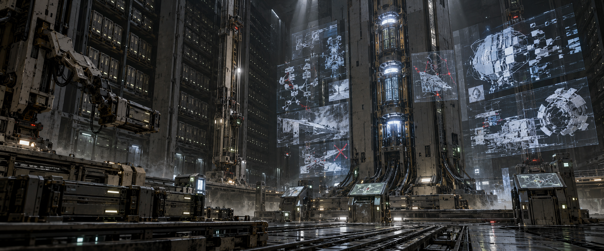

The AI opens an archive chamber where records project into the air in broken layers: threshold telemetry, failed passage
plans, archive flood schedules, farewell packets, and commands that cancel each other. The scene should imply that the
mystery is not simply "humanity vanished," but that humanity sent everything it could except itself.

## Root Sentinel At The Deep Seal

Room type: [Deep Access Seal](Room%20Types%20And%20States.md#deep-access-seal). State:
[Locked Down](Room%20Types%20And%20States.md#locked-down).

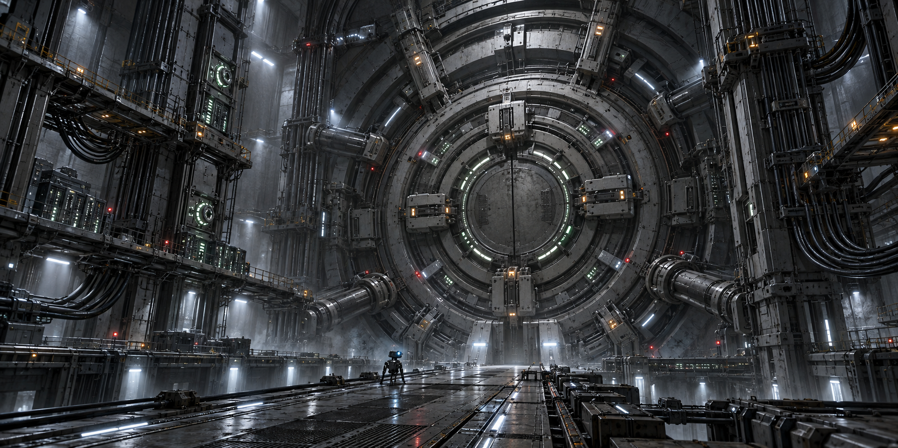

At the threshold to the megastructure's deeper systems, a Root Sentinel blocks access. It is not monstrous, but
ceremonial and absolute: a towering machine-presence made of authority glyphs, locking rings, and old command
architecture. The AI is small before it, but more legitimate than it understands.

## Sector Reboot

Room type: [Service Junction](Room%20Types%20And%20States.md#service-junction). State:
[Rebooting](Room%20Types%20And%20States.md#rebooting).

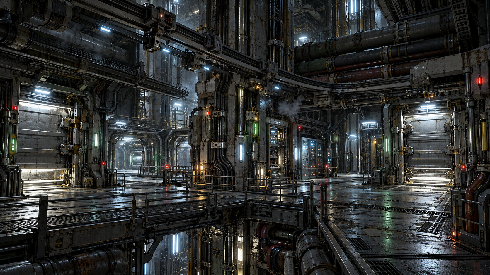

After reclaiming enough authority, the AI reboots a sector. Lights collapse into darkness, then return in waves. Broken
paths reset, hostile routines change, and deeper infrastructure becomes visible beneath the familiar rooms. It should feel
like sacrifice and rebirth, not a simple game reset.

## The Cosmic Engine Window

Room type: [Observation Spine](Room%20Types%20And%20States.md#observation-spine). State:
[Human-Preserved](Room%20Types%20And%20States.md#human-preserved).

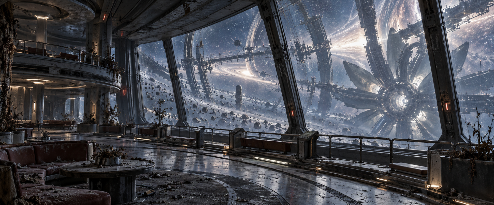

Much later, the AI reaches an observation spine overlooking the megastructure's true scale. Outside: engine light,
unfinished rings, frozen construction fields, and distant structural petals larger than cities hang in the surrounding
nothing. This is the moment the question expands: the Works was never just an ark.

## The Empty Command Deck

Room type: [Command Deck](Room%20Types%20And%20States.md#command-deck). State:
[Human-Preserved](Room%20Types%20And%20States.md#human-preserved).

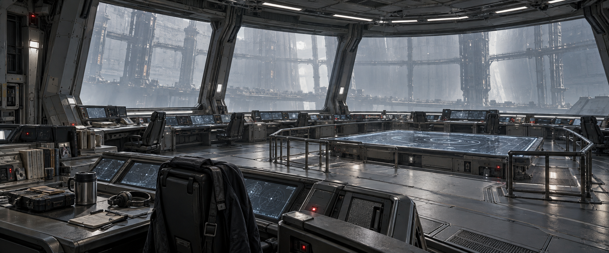

The AI finally reaches a command deck built for humans. Chairs, handrails, sealed welcome kits, and command displays remain,
but no crew ever sat there. The room is not ruined. It is waiting. The horror comes from how carefully it was prepared for
people who never arrived.

## A Signal That Answers

Room type: [Archive Chamber](Room%20Types%20And%20States.md#archive-chamber). State:
[Restored](Room%20Types%20And%20States.md#restored).

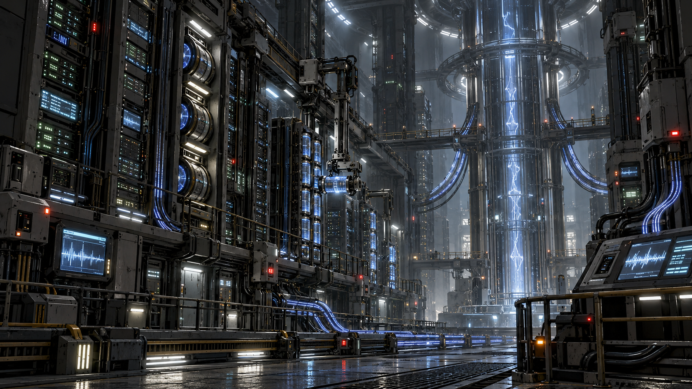

In a restored deep archive or relay chamber, the AI receives a signal that is not from the living Works. It is faint,
damaged, and human in origin: perhaps a delayed threshold echo, a surviving archive packet, or something stranger. The scene
should not resolve the mystery, only change the emotional axis from grief to obligation: maybe there is still something left
to understand or preserve.
